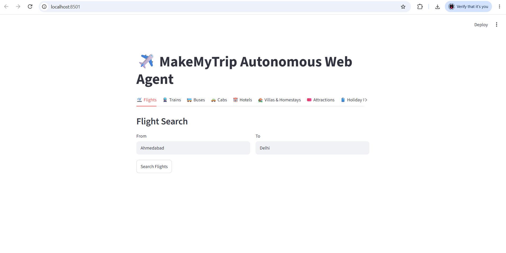
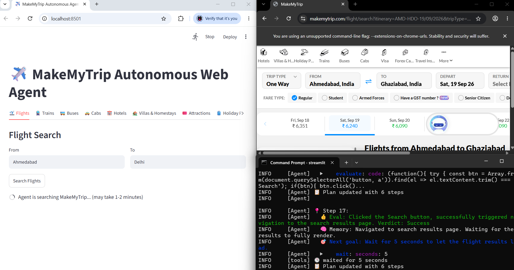
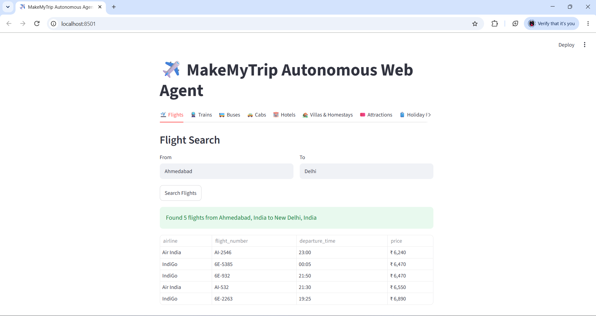

# ✈️ MakeMyTrip: Autonomous Web Operations Agent

An autonomous GenAI-powered agent that operates the MakeMyTrip website — searching Flights, Trains, Buses, Cabs, Hotels, Villas, Attractions, Holiday Packages, and Cruises — using natural language task instructions, without any hardcoded selectors, and without using any paid API (Claude/OpenAI).

## 🎯 Project Overview

Traditional web scraping/automation requires hardcoded CSS selectors that break every time a website's UI changes. This project instead uses an **LLM-driven reasoning loop**: the agent looks at the live page (DOM + screenshot), decides the next best action (click, type, scroll), executes it via a real browser, and repeats until the goal is achieved — just like a human would.

## 🏗️ Architecture

```
User Task (natural language)
        ↓
   LLM Brain (Google Gemini - free tier)
        ↓  reads DOM + screenshot of current page
   Decides next action (click / type / scroll / navigate)
        ↓
   Playwright executes action on real Chromium browser
        ↓
   New page state captured → loop back to LLM
        ↓
   Repeat until task complete (or safety limit reached)
        ↓
   Structured JSON output (via Pydantic schema)
```

## 🎬 Demo & Visuals

All demo material — screenshots, the screen-recorded demo video, and the project presentation — is available in the [`Agent_Visuals/`](./Agent_Visuals) folder.

| # | Screenshot | What it shows |
|---|---|---|
| 1 | `Agent_Visuals/1.png` | Streamlit UI — Flights tab active, first half of the 9 service tabs visible (Flights → Holiday Packages) |
| 2 | `Agent_Visuals/2.png` | Streamlit UI — scrolled tab bar showing the remaining tabs (Buses → Cruises), confirming all 9 services are wired up |
| 3 | `Agent_Visuals/3.png` | Agent running — "Agent is searching MakeMyTrip..." spinner after clicking Search |
| 4 | `Agent_Visuals/4.png` | Live browser + terminal side-by-side — agent typing From/To and navigating on makemytrip.com |
| 5 | `Agent_Visuals/5.png` | Real MakeMyTrip flight results page being read by the agent |
| 6 | `Agent_Visuals/6.png` | Agent extracting top 5 flights + returning structured JSON (terminal log, "Task completed successfully") |
| 7 | `Agent_Visuals/7.png` | Final Flights result rendered as a table inside the Streamlit app |
| 8 | `Agent_Visuals/8.png` | Final Hotels result rendered as a table inside the Streamlit app |
| 9 | `Agent_Visuals/9.png` | Terminal log — Hotels search completed, saved to `results/hotels_Goa_*.json` |

**Demo video:** a short screen recording of a live search (button click → live MakeMyTrip automation → structured result) is included in `Agent_Visuals/`.

**Presentation:** the full project walkthrough deck — architecture, tech stack, challenges, and results — is included as `Agent_Visuals/MakeMyTrip_Autonomous_Agent.pptx`.

> Sample screenshots:
>
> 
> 
> 

## 🛠️ Tech Stack

| Component | Technology |
|---|---|
| Agent framework | [browser-use](https://github.com/browser-use/browser-use) (open-source) |
| Browser automation | Playwright (Chromium) |
| LLM | Google Gemini (`gemini-flash-lite-latest`) — **free tier, no paid API used** |
| Structured output | Pydantic schemas |
| Frontend | Streamlit |
| Language | Python 3.x |

## ✨ Features

- 9 fully autonomous modules: Flights, Trains, Buses, Cabs, Hotels, Villas, Attractions, Holiday Packages, Cruises
- Automatic popup/login-modal detection and dismissal
- Structured JSON output with Pydantic schema validation
- Results auto-saved as timestamped JSON files (`results/` folder)
- Interactive Streamlit web UI with tabs for each service
- Built-in safety guardrail: **never proceeds to payment/booking**

## 📂 Project Structure

```
mmt-agent/
├── Agent_Visuals/        # Screenshots, demo video, and presentation (.pptx)
├── venv/                  # Python virtual environment
├── logs/                  # Agent conversation/debug logs
├── results/               # Timestamped JSON outputs per search
├── __pycache__/
├── .env                   # API keys (not committed)
├── agent_core.py          # Reusable search functions for all 9 services
├── app.py                 # Streamlit UI
├── requirements.txt       # Exact dependency versions
├── test_key.py            # Standalone LLM connectivity check
└── README.md
```

## ⚙️ Setup Instructions

1. Clone/create the project folder and set up a virtual environment:
   ```bash
   python -m venv venv
   venv\Scripts\activate
   ```
2. Install dependencies:
   ```bash
   pip install -r requirements.txt
   python -m playwright install chromium
   ```
3. Get a **free** Gemini API key from https://aistudio.google.com/apikey and add it to `.env`:
   ```
   GEMINI_API_KEY=your_key_here
   ```
4. Run the app:
   ```bash
   streamlit run app.py
   ```

## 🧠 How It Works (Agent Loop)

For each task, the agent is given a natural-language instruction (e.g., *"Go to makemytrip.com, search flights from Ahmedabad to Delhi, extract top 5 results"*). Internally, `browser-use`:
1. Captures the current page's accessibility tree + screenshot
2. Sends it to Gemini along with the task and action history
3. Gemini responds with the next action (e.g., `click index: 5138`)
4. Playwright executes that action in the real browser
5. Steps 1–4 repeat until the LLM calls `done`, extracting the final structured result

## ⚠️ Challenges Faced & Solutions

| Challenge | Solution |
|---|---|
| `503 UNAVAILABLE` errors from Gemini (server overload) | Switched to `gemini-flash-lite-latest`, added fallback LLM support |
| Login/promo popups blocking interaction | Added explicit popup-handling instructions in every task prompt |
| Calendar widgets covering the Search button | Agent adaptively re-queried the DOM using `evaluate`/`find_elements` |
| Copy-paste filename bug across multiple functions | Standardized dynamic filenames per service (`{service}_{params}_{timestamp}.json`) |
| Unstructured text output | Enforced Pydantic `output_model_schema` for consistent JSON |

## 🔒 Safety & Ethical Considerations

- The agent is explicitly instructed to **never proceed past the results page** — no payment, no booking confirmation.
- No real user account credentials or payment details are ever entered.
- Built strictly for **educational/demo purposes**; not intended for production-scale scraping or commercial use against MakeMyTrip's Terms of Service.
- Free-tier API used throughout — no paid LLM API required.

## 🚀 Future Enhancements

- Add price-comparison logic across multiple searches
- Add date-range flexibility (currently uses nearest available date)
- Deploy Streamlit app for remote access
- Add caching to avoid redundant searches within a session