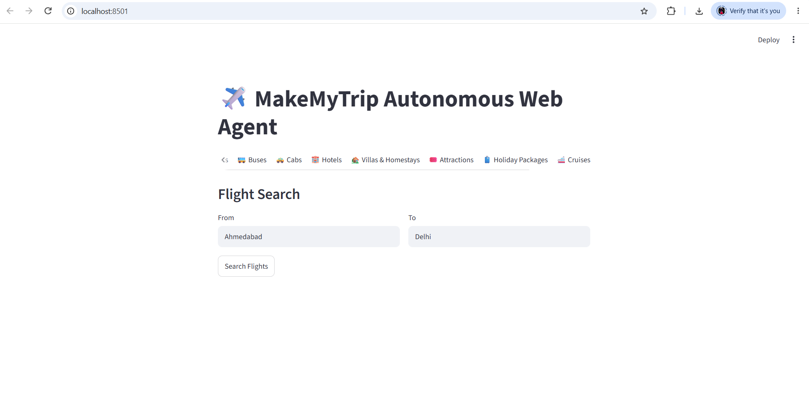
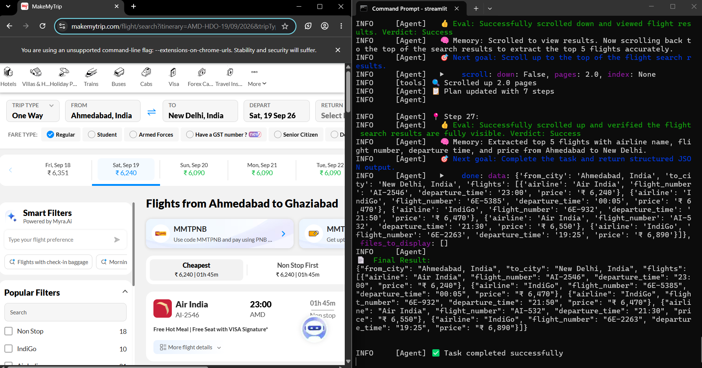
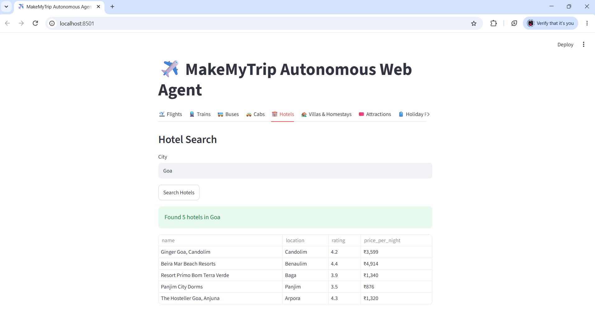

# ✈️ MakeMyTrip Autonomous Web Agent

An AI agent that **uses a real browser like a human** to search MakeMyTrip, read the results, and return clean, structured data, all on a **100% free stack** (Gemini free tier, no paid API).

Give it a task like *"cheapest flights Delhi → Goa for the next 2 days"* and it opens Chrome, searches, scrolls, reads the page and returns validated JSON, shown in a simple Streamlit dashboard.

---

## 🎬 Demo

▶️ **[Watch the demo video](Agent_Visuals/Demo_Video_%28Deployment%29.mp4)**

> Ctrl+click the link to open the demo video in a new tab.

---

## ✨ Features

- **9 services in one app:** Flights, Trains, Buses, Cabs, Hotels, Villas & Homestays, Attractions, Holiday Packages, Cruises
- **Autonomous browsing:** the agent perceives the page, reasons about it, acts, and repeats, so it does not rely on fragile hard-coded selectors
- **Structured output:** every result follows a Pydantic schema (for example airline, flight number, departure time, price) and is saved as a timestamped JSON file in `results/`
- **Guided Streamlit UI:** click a service tile, fill a numbered form (Route → Mode → Dates → Travellers)
- **Cheapest fare per date (Fast mode):** one search compares the lowest fare across a window of days
- **Results dashboard:** cheapest, most expensive and average fare, a planning tip, a fare trend chart, top 5 cheapest dates, and **CSV download**
- **Travellers support:** adults, children (>2 yrs) and infants (<2 yrs, one per adult)

---

## 🖼️ Screenshots

| Home: 9 services | Flights form |
|---|---|
|  |  |

| Cheapest fare per date | Results and chart |
|---|---|
|  |  |

| Agent at work (browser + log) | Flights output (terminal) |
|---|---|
|  |  |

---

## 🧠 How it works

```
User task  →  LLM brain (Gemini)  →  Action  →  Browser (Playwright)
     ▲                                                   │
     └─────────────  Perceive → Reason → Act → Repeat ───┘
```

1. You pick a service and fill the form in Streamlit.
2. The form becomes a focused task prompt for the agent.
3. The agent drives a real Chromium browser on makemytrip.com, scrolling and reading the results.
4. After every step it evaluates the outcome and sets its next goal.
5. It returns data that matches a Pydantic schema, which the UI renders and saves to `results/`.

### Example output

```json
{
  "airline": "Air India",
  "flight_number": "AI-2938",
  "departure_time": "18:55",
  "price": "₹ 7,048"
}
```

---

## 🛠️ Tech stack

| Layer | Tool | Version |
|---|---|---|
| Agent framework | [browser-use](https://github.com/browser-use/browser-use) | 0.13.10 |
| Browser automation | Playwright (Chromium) | 1.62.0 |
| LLM | Google Gemini via `google-genai` (free tier, Google AI Studio) | 1.65.0 |
| Data validation | Pydantic | 2.13.5 |
| Data handling | pandas | 3.0.5 |
| Configuration | python-dotenv | 1.2.2 |
| UI | Streamlit | 1.63.0 |
| Language | Python | 3.14.7 |

---

## 📁 Project structure

```
Make_My_Trip_Autonomous_Web_Agent/
├── .streamlit/
│   └── config.toml          # Streamlit configuration
├── Agent_Visuals/           # Demo video, screenshots and project story slides
│   ├── 1.png … 8.png
│   ├── Demo_Video_(Deployment).mp4
│   └── MakeMyTrip_Agent_Operation_Story.pptx
├── agent_core.py            # Core agent logic (browser agent, task prompts, schemas)
├── app.py                   # Streamlit app (home, service forms, results dashboard)
├── theme.py                 # UI theme and styling
├── competitor_test.py       # Test script
├── test_key.py              # Quick check that the API key works
├── Dockerfile               # Container setup
├── .dockerignore
├── package.json
├── requirements.txt         # Python dependencies
├── .gitignore
└── README.md
```

---

## 🚀 Getting started

**Prerequisite:** Python 3.14.7 (the version this project was built and tested with)(Best versions are >= Python 3.11+).

### 1. Clone and install

```bash
git clone https://github.com/nstrivedi/Make_My_Trip_Autonomous_Web_Agent.git
cd Make_My_Trip_Autonomous_Web_Agent

python -m venv venv
venv\Scripts\activate        # Windows
# source venv/bin/activate   # macOS / Linux

pip install -r requirements.txt
playwright install chromium
```

### 2. Add your free Gemini API key

1. Get a free key from [Google AI Studio](https://aistudio.google.com/) (no credit card needed).
2. Create a `.env` file in the project root:

```env
GEMINI_API_KEY=your_api_key_here
```

> ⚠️ Never commit `.env`. It is listed in `.gitignore`.

### 3. Run the app

```bash
streamlit run app.py
```

Open **http://localhost:8501**, choose a service, and start searching.

---

## 📖 Usage

1. Click a service tile (for example **Flights**).
2. **Route:** type From and To (for example `delhi` → `goa`).
3. **Mode:** *Single date*, or *Cheapest fare per date (Fast)*.
4. **Dates:** pick a start date and how many days to compare.
5. **Travellers:** set adults, children and infants.
6. Click **Get cheapest fares** and watch the agent work. A multi-day search visits several pages and can take a few minutes.
7. Review the metrics, chart and tables, then **Download CSV** if you want the data.

---

## ⚠️ Known limitations

- **Date chart axis:** with very few dates, the fare chart can show hours instead of dates. A categorical date axis is planned.
- **City → airport mapping:** a city name such as "New Delhi" may resolve to a different airport code on the site. Mapping each city to a fixed IATA code is planned.
- **Free-tier LLM limits:** Gemini's free tier can rate-limit heavy use, so long runs may need a retry.
- **Website changes and bot protection:** MakeMyTrip may change its layout or show captchas, which can slow or block the agent.
- **Cloud hosting:** the agent needs a real Chromium browser, so it is best run on your own machine. Free Streamlit and Hugging Face tiers are not a good fit for it.

---

## 🗺️ Roadmap

- [ ] Fix the fare chart date axis
- [ ] Explicit city → IATA mapping
- [ ] Retry and back-off for LLM rate limits
- [ ] Simple password gate for shared demos
- [ ] 🚧 More agent capabilities are under active development and will be rolled out in upcoming updates

---

## ⚖️ Disclaimer

This is an educational and portfolio project. It is not affiliated with or endorsed by MakeMyTrip. Prices and availability are read from the public website at run time and may differ from what you see when booking. Please respect the website's terms of use and avoid heavy or repeated automated requests.

---

## 👤 Author

**Nishant Shaileshkumar Trivedi** · [GitHub](https://github.com/nstrivedi) · [LinkedIn](https://www.linkedin.com/in/nstrivedi)

⭐ If you found this useful, consider starring the repo.
